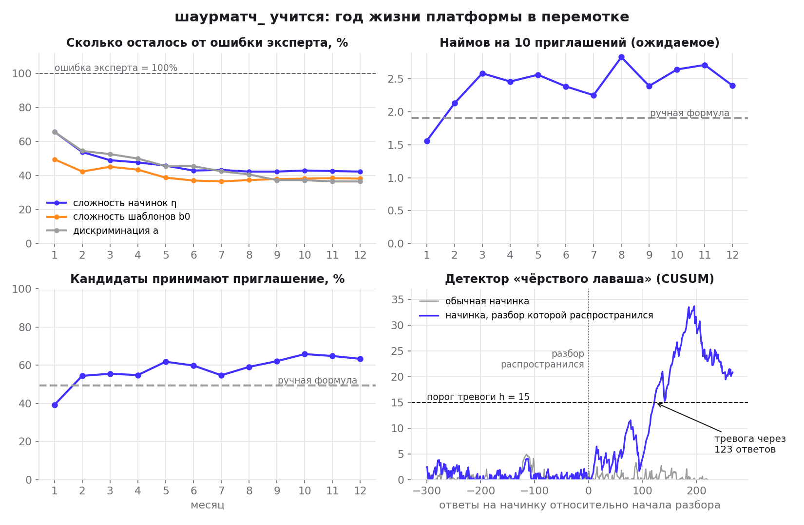
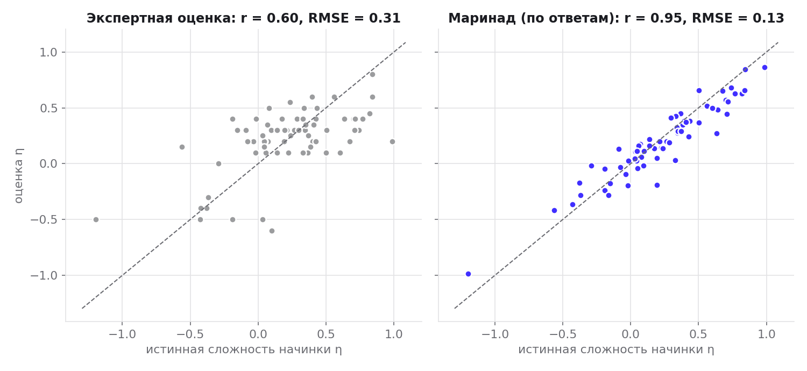
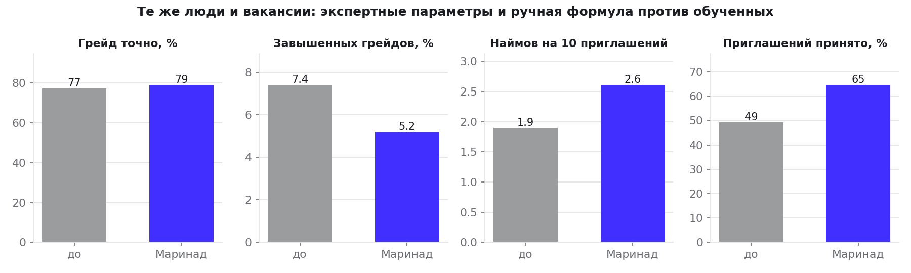
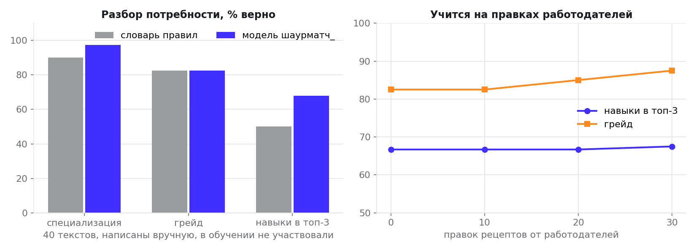
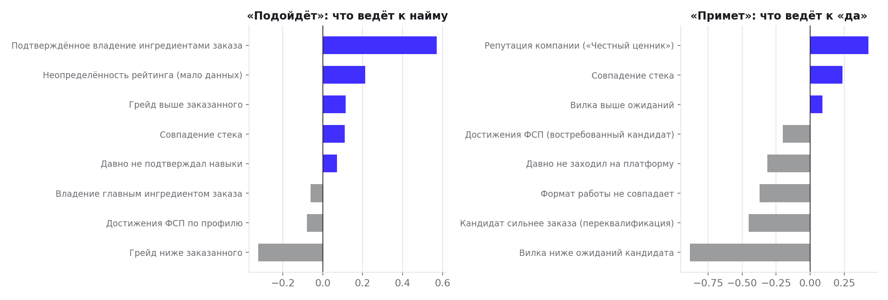

# «Маринад»: отчёт симуляции обучения на данных платформы

Три модели платформы дообучаются на действиях пользователей в продукте. Отдельная разметка и внешние API
для этого не нужны.

| Действие в продукте | Чему учит | Модель |
|---|---|---|
| Кандидат отвечает на задание теста | Сложность каждой начинки и шаблона, их различающую силу | Калибровка LLTM + 3PL (MML-EM с априорными распределениями вокруг экспертных значений) |
| Работодатель правит рецепт ползунками | Как текст потребности превращается в навыки | Собственная языковая модель «текст в рецепт» (символьные n-граммы, линейные головы) |
| Кандидат принимает или отклоняет приглашение, работодатель отмечает найм | Кого приглашать, чтобы найм состоялся | Двусторонний ранжировщик: P(подойдёт) × P(примет) |

Код: `engine/app/learn/`, симуляция: `engine/training/marinate.py`, сырые цифры: `metrics.json`.
Все модели — открытые JSON-файлы с весами, без pickle и обфускации.

## 1. Год жизни платформы в ускоренной перемотке

Синтетический мир с известной истиной: эксперт ошибся в сложностях заданий примерно так же,
как ошибаются эксперты в психометрической литературе, у кандидатов есть скрытые навыки по каждому ингредиенту,
а решения «принять приглашение» и «нанять» они принимают по скрытым правилам (деньги, формат,
переквалификация, репутация компании, истинное совпадение навыков). Каждый месяц приходят
300 кандидатов и 30 вакансий, а в конце месяца модели дообучаются.

| | Месяц 1 | Месяц 12 |
|---|---|---|
| Накоплено ответов на задания | 7,481 | 85,864 |
| Ошибка сложности начинок η, RMSE (эксперт: 0.312) | 0.205 | **0.13** |
| Ошибка базовой сложности шаблонов, RMSE (эксперт: 0.361) | 0.179 | **0.138** |
| Ошибка дискриминации, RMSE log a (эксперт: 0.268) | 0.176 | **0.098** |
| Наймов на 10 приглашений | 1.556 | **2.393** |
| Приглашений принято | 39% | **63%** |

## 2. До и после на одних и тех же людях

Свежая когорта из 2000 кандидатов проходит тест дважды на одних и тех же случайных числах:
с экспертными параметрами и с выученными. 150 новых вакансий ранжируются ручной формулой ШАУРМЫ
и обученным ранжировщиком.

| Метрика | До (эксперт / формула) | После (Маринад) |
|---|---|---|
| Грейд определён точно | 77.3% | **79.1%** |
| κ Коэна (квадратичная) | 0.875 | **0.88** |
| Доля завышенных грейдов | 7.4% | **5.2%** |
| Наймов на 10 приглашений | 1.899 | **2.609** |
| Приглашений принято | 49% | **65%** |

## 3. Детектор «чёрствого лаваша»

Банк шаблонов ШАУРМЫ открыт, и ответы не утекают: варианты уникальны. Но может «утечь приём»:
разбор приёма начинки распространился, и задание перестаёт различать сильных и слабых. В 7-м месяце
так случилось с начинкой «Бинарный поиск: границы: строгое/нестрогое сравнение» (`py_binary_search:upper`): 70% новых кандидатов видели разбор.

Для каждого ответа считается остаток «ответ минус предсказание текущей модели». У любой начинки есть постоянное
небольшое несоответствие модели, поэтому детектор ищет не отклонение от нуля, а **изменение**: после разогрева
(150 ответов) он копит CUSUM по отклонению остатков от собственной прошлой нормы начинки (k = 0.3, h = 15.0).
Детектор поднял тревогу в 7-м месяце, через **123 ответа** на эту начинку после начала разбора, и оценил, что она стала легче на **0.58 логита**. История этой начинки обнулилась, и следующая калибровка выучила её новую сложность.
Сложность этой начинки: эксперт +0.35, истинная до разбора -0.19, после разбора в среднем по кандидатам -1.10; «Маринад» к концу года выучил **-0.87**.
Ложных тревог на других начинках за год: 0.

## 4. Своя языковая модель вместо словаря

Корпус — 8,000 сгенерированных описаний потребностей (банки формулировок по навыкам, грейдам и стекам;
парсить чужие вакансии ТЗ запрещает). Проверка — на **40 текстах, написанных вручную отдельно**
и генератором не порождаемых: в них много формулировок, которых нет в словаре («двойные списания»,
«одно место продаётся двум людям», «трёхзначная логика»).

| | Словарь правил | Модель шаурматч_ |
|---|---|---|
| Специализация | 90% | **98%** |
| Грейд | 82% | **82%** |
| Заказанные навыки в топ-3 рецепта | 50% | **68%** |

Обучение на правках (4 фолда: модель видит k вручную размеченных текстов как «правки работодателей»
и проверяется на остальных): навыки в топ-3 67%, 67%, 67%, 68%,
грейд 82%, 82%, 85%, 88% при k = 0, 10, 20, 30.

## 5. Чему научился подбор

Веса обеих голов открыты и названы по-русски, поэтому подбор остаётся объяснимым:
работодатель видит не только «почему кандидат подходит», но и «примет ли он ваше приглашение».

## Как это работает в продукте
- **Калибровка теста** учится только на живых ответах: в образ она не запекается, иначе тест выучил бы
  сложности вымышленного мира. Пока ответов мало, априорное распределение держит параметры у экспертных значений.
  Пересчёт запускается автоматически каждые 300 новых ответов и пишется в журнал версий (`model_versions`).
- **Ранжировщик** стартует с весов, выученных на симуляции («тёплый старт»), и дообучается на реальных
  ответах на приглашения с L2-притяжением к стартовым весам.
- **Языковая модель** запечена в образ (корпус + ручные тексты) и переобучается, когда работодатель правит рецепт.
- **Откат** к экспертным параметрам — одна команда; каждая версия модели хранится с метриками.

## Ограничения
- Мир синтетический: абсолютные цифры зависят от допущений о поведении людей. Механизм проверен,
  величина эффекта на реальном рынке будет другой.
- Ручная выборка для языковой модели маленькая (40 текстов), поэтому погрешность около ±7 п. п.
- Ранжировщик учится на приглашениях, которые сам же и предложил. Чтобы не замкнуться на собственном топе,
  одно из пяти приглашений в симуляции — «тёмная лошадка» из топ-30.
