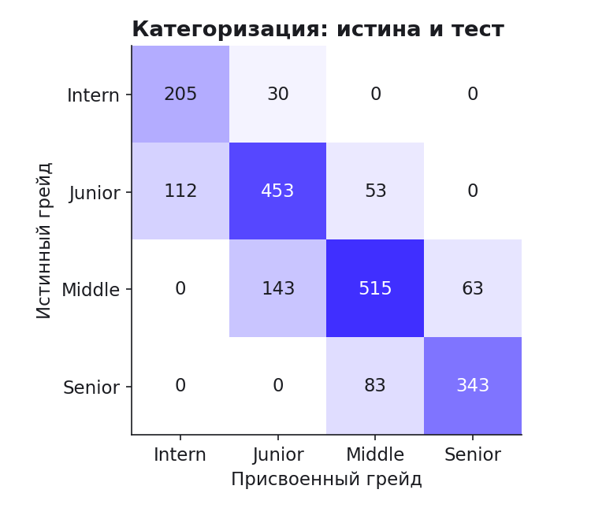
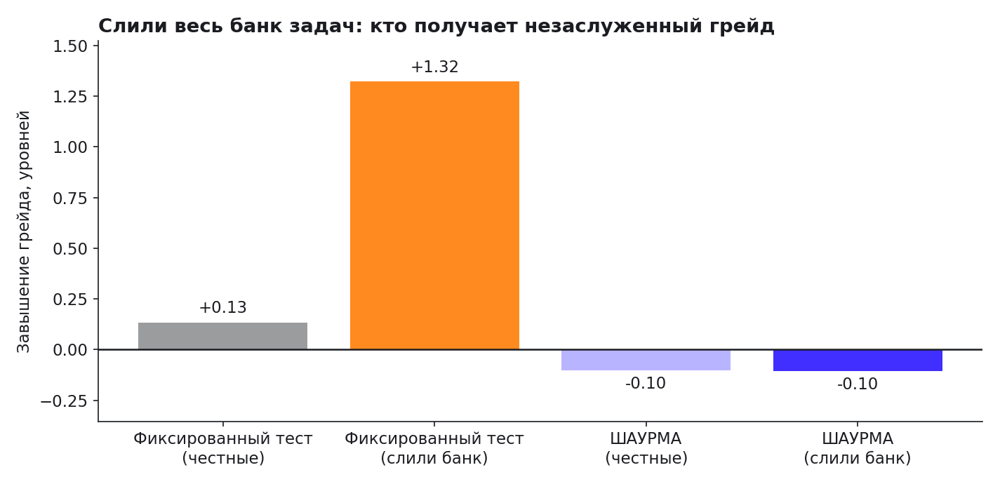
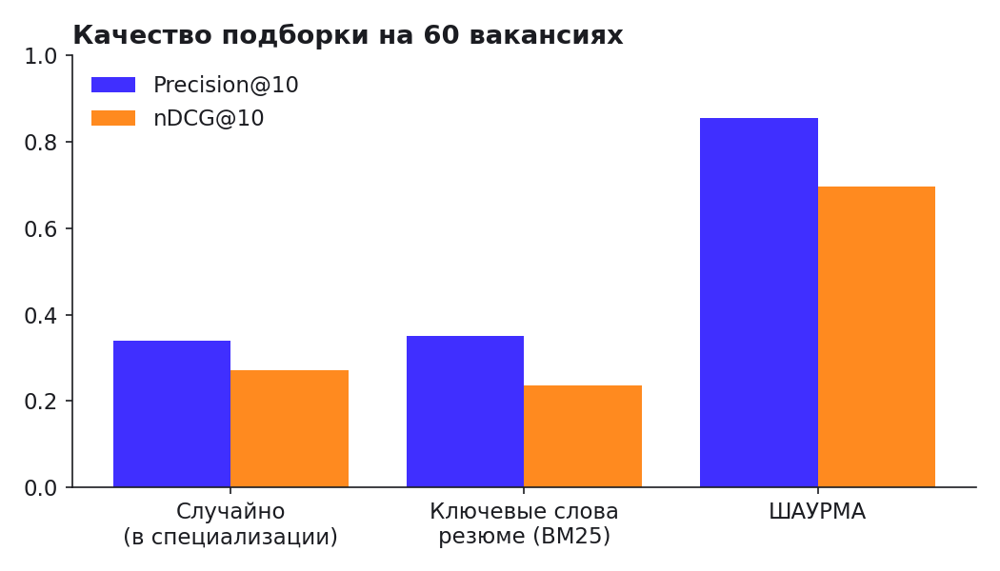

# Отчёт валидации метода ШАУРМА

Синтетическая популяция: **2000 кандидатов** (seed 42) с известными истинными навыками
по каждому ингредиенту; самооценка грейда с типичным завышением (30% завышают на уровень). Ответы
моделируются по 3PL-модели от истинных навыков ингредиентов задания (многомерная истина при одномерном тесте —
проверка устойчивости). Скрипт: `engine/validation/simulate.py`, сырые цифры: `metrics.json`.

## 1. Категоризация
| Метрика | Значение |
|---|---|
| Точное совпадение грейда с истиной | **76%** |
| Совпадение ±1 уровень | **100%** |
| Квадратично-взвешенная κ Коэна | **0.87** |
| Доля завышенных грейдов | 7% |
| Среднее число попыток (включая тест на уровень ниже) | 1.31 |
| Восстановление профиля ингредиентов (ρ Спирмена, среднее) | **0.671** |

## 2. Стабильность (тест-ретест на разных уникальных вариантах)
| Метрика | Значение |
|---|---|
| Совпадение грейда при повторном прохождении | **75%** |
| κ (квадратичная) тест-ретест | **0.864** |

## 3. Дискриминативность заданий
Средняя точечно-бисериальная корреляция «верно ↔ истинный уровень»: **0.341**
(ориентир психометрики: > 0.2 — приемлемо, > 0.3 — хорошо). Максимальная доля показов одного шаблона: 4.3%.

## 4. Устойчивость к сливу
Сценарий: кандидаты знают **весь** банк задач и ответы на чужие варианты.

| | Завышение грейда |
|---|---|
| Фиксированный тест, честные | +0.13 |
| Фиксированный тест, слили банк | **+1.32** |
| ШАУРМА, честные | -0.10 |
| ШАУРМА, слили банк | **-0.10** |

Канарейки поймали **92%** списывающих при ложных срабатываниях на честных **1.3%**
(порог — 2 совпадения с ответами чужих вариантов; подозрение ведёт не к бану, а к уточняющим вопросам).

## 5. Подбор (60 вакансий, истинная релевантность известна)
| Подход | Precision@10 | nDCG@10 |
|---|---|---|
| Случайно внутри специализации | 0.34 | 0.272 |
| Ключевые слова резюме (BM25) | 0.35 | 0.235 |
| **ШАУРМА** (категория + ингредиенты + рейтинг) | **0.855** | **0.697** |

## Ограничения
* Мир синтетический: абсолютные значения зависят от допущений модели ответов. На реальных данных
  сложности η операторов и дискриминации заданий калибруются заново (LLTM-регрессия по накопленным ответам).
* «Приукрашивание» резюме (30% кандидатов) — допущение; именно от него страдает BM25.
