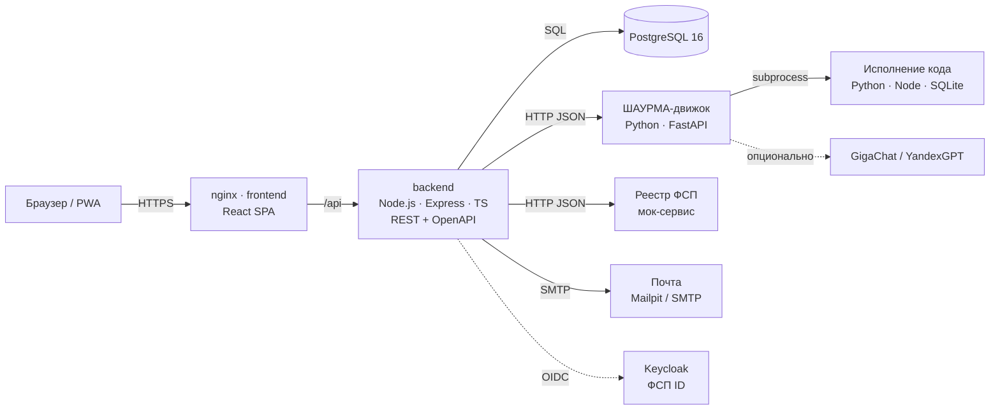

# Архитектура шаурматч_

## 1. Функциональная архитектура

| Роль | Функции | Где в коде |
|---|---|---|
| **Кандидат** | Регистрация по email с подтверждением; профиль вручную или из PDF-резюме (автораспознавание); стандартизированный PDF-профиль; опрос по отрасли и специализации; выбор грейда; адаптивный тест; категория и история; тест на грейд ниже или выше (не чаще раза в 90 дней); входящие приглашения (принять, отклонить с причиной); «Ценник не врёт»; вакансии и отклики; регулярные задачи; приватность и согласия; связь с ID ФСП | `backend/src/routes/candidate.ts`, `tests.ts`, `invitations.ts`, `vacancies.ts`, `tasks.ts` |
| **Работодатель** | Профиль компании; описание потребности и рецепт навыков по нему; подборка по категориям с объяснением; уточняющие фильтры поверх подборки; банк кандидатов с фильтрами (специализация, грейд, категория, стек, ФСП); карта рынка; приглашение с вилкой без обязательной вакансии; статусы приглашений; вакансии и отклики; «Слепая дегустация» | `backend/src/routes/employer.ts`, `vacancies.ts`, `tasks.ts` |
| **ШАУРМА-движок** | Генерация уникальных вариантов (эталон получается исполнением кода); сложность по LLTM; адаптивный тест и решение по грейду; Glicko-2 по ингредиентам; рецепт по тексту; матчинг с объяснением; канарейки и person-fit; разбор резюме; валидация | `engine/app/*`, `engine/validation/simulate.py` |
| **Реестр ФСП (мок)** | Участник по ID: дисциплины, соревнования, уровень, место, число участников, команда, роль, разряд | `fsp-mock/server.js` |

### Правила видимости (ТЗ, п. 2.2)
- Зарплата «от–до» в ₽ обязательна в вакансии и в приглашении: это проверки на уровне схемы API (zod) и ограничения `CHECK` в БД.
- Контакты кандидата (email, телефон, Telegram, ФИО) работодатель получает **только** если кандидат принял его приглашение или откликнулся на его вакансию (функция `contactsVisible` в `services/candidate.ts`). До этого показывается «Кандидат #код». Город и зарплату кандидат может скрыть в настройках.
- Кандидат видит только свои приглашения и отклики: все запросы фильтруются по `candidate_id = req.user.id`.
- Статусы приглашений и откликов: `sent`, затем `viewed`, затем `accepted` или `declined`.
- Выдача формируется только из кандидатов с категорией, присвоенной тестом (`grade IS NOT NULL`) и согласием на публикацию профиля.

## 2. Компонентная архитектура

- **Монолит с явным разделением слоёв плюс отдельный вычислительный сервис.** Backend отвечает за данные, права и бизнес-правила. Движок не хранит состояния: он только считает, поэтому масштабируется горизонтально.
- **Эталон без нейросети.** Правильный ответ каждого варианта получается исполнением сгенерированного кода (Python, Node.js, SQLite). LLM используется только для необязательного уточнения рецепта и разбора резюме, а без ключей система работает на правилах.
- **Хранение.** Реляционная PostgreSQL. Рейтинги Glicko-2 по ингредиентам хранятся в `jsonb` у кандидата, варианты заданий — в `test_items` (это нужно для проверки канареек и аудита).

### Модель данных (основное)
`users` связана с `candidates` (1:1) или `companies` (1:1); `candidate_categories` (все подтверждённые тестом категории кандидата: основная + дополнительные; представление `candidate_category_view` — одна строка на кандидата и категорию, по нему ищет работодатель); `test_sessions` и вопросы `test_items`; `grade_history`; `needs` (рецепт `jsonb`); `vacancies` и отклики `applications`; `invitations`; `tasks` и решения `task_submissions` (`tasks.kind`: `employer` — «Слепая дегустация» для категории, `system` — «Свежая начинка», адресная задача кандидату). Схема: `backend/migrations/001_init.sql`.

### «Маринад»: обучение на данных платформы
Backend (`services/learning.ts`) решает, когда пора учиться: каждые 300 ответов на задания, 20 ответов на приглашения,
после каждой правки рецепта. Он собирает данные из БД и вызывает движок (`/learn/*`). Движок обучает модель и
пишет её как открытый JSON в docker-том `models`. Все воркеры подхватывают новую версию по времени изменения файла.
Журнал версий хранится в таблице `model_versions`, состояние триггеров — в `learning_state`.
Обучение идёт в фоне: пользователь не ждёт. Подробно: [МАРИНАД.md](МАРИНАД.md).

## 3. Безопасность и 152-ФЗ
- Пароли хешируются bcrypt. JWT лежит в httpOnly-cookie (SameSite=Lax), также поддерживается `Authorization: Bearer`.
- Роли проверяются на каждом методе (`requireRole`). Все SQL-запросы параметризованы.
- Ограничение частоты запросов на вход, регистрацию и подтверждение email. Используется helmet, CORS разрешён только для `PUBLIC_URL`.
- Согласие на обработку ПДн обязательно перед тестом. Согласие на публикацию обезличенного профиля — отдельно. Дата согласия сохраняется.
- Минимизация данных: работодатель видит категорию, рейтинги и стек без контактов, пока кандидат не дал согласие на контакт.
- Модели. Тест, подбор и разбор текста работают на собственных открытых моделях шаурматч_ (без внешних API). LLM — необязательная надстройка: адаптер поддерживает GigaChat и YandexGPT, организаторы допускают и зарубежные модели (предпочтительнее открытые). В LLM не передаются контакты; разбор резюме по LLM включается только при наличии ключа.

## 4. Производительность
- Подборка по потребности строится за один запрос к БД по индексу `(specialization, grade)` и один вызов движка (векторная арифметика по сотням кандидатов). При 360+ кандидатах это десятки миллисекунд.
- Генерация варианта: 1–5 запусков кода, около 50 мс каждый, с LRU-кэшем. Шаг адаптивного теста — EAP на сетке numpy, около 1 мс.
- Движок работает с двумя воркерами uvicorn. Backend и движок масштабируются репликами, так как состояние хранится в PostgreSQL.

## 5. Интеграции
- **ФСП:** см. [ИНТЕГРАЦИЯ ФСП.md](ИНТЕГРАЦИЯ%20ФСП.md).
- **ATS (концепция):** приглашения и статусы публикуются вебхуком (`invitation.created`, `invitation.status_changed`) в ATS компании (Хантфлоу, Potok, E-Staff). Импорт вакансий из ATS идёт по их API. Адаптер — отдельный модуль backend по шаблону `services/fsp.ts`.
- **Защита от фиктивных вакансий («Честный ценник»):** лимит приглашений в неделю (5 + репутация/10), талон возвращается после ответа кандидата. Кандидат подтверждает, совпала ли зарплата с вилкой: «нет» снижает репутацию на 25 и снимает бейдж. Дальнейшее развитие — сигналы фиктивности: вакансия без найма месяцами, одинаковые тексты, вилка-приманка.
