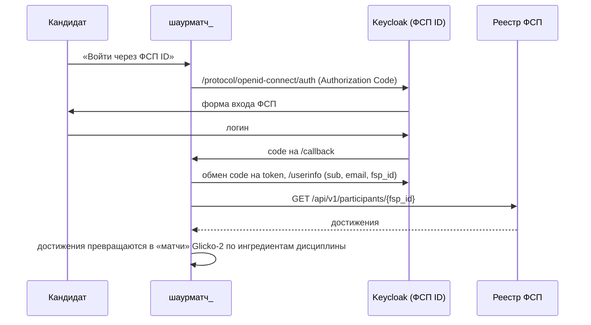

# Схема интеграции с реестром ФСП

ТЗ (п. 4): API и структура данных ФСП в рамках хакатона не предоставляются, команда сама предлагает, какие сведения получать и как их показывать. Ниже — наше предложение. Оно реализовано в мок-сервисе `fsp-mock/` и в клиенте `backend/src/services/fsp.ts`.

## 1. Идентификация: ФСП ID на Keycloak

- Реализовано в `backend/src/routes/auth.ts`. Включается переменными `KEYCLOAK_*`; демо-realm лежит в `keycloak/realm-fsp.json`, запуск — `docker-compose.keycloak.yml`.
- Без Keycloak кандидат вводит ID участника вручную: `POST /api/v1/candidate/fsp/link`. Если ID уже привязан к другому профилю, возвращается 409. В промышленной версии привязку нужно подтверждать входом через ФСП ID.

## 2. Предлагаемая структура данных реестра
`GET /api/v1/participants/{fsp_id}`
```json
{
  "fsp_id": "FSP-2025-0001",
  "full_name": "Алексей Смирнов",
  "region": "Москва",
  "achievements": [{
    "event": "Чемпионат России по спортивному программированию 2025",
    "date": "2025-11-20",
    "discipline": "product",
    "discipline_title": "Продуктовое программирование",
    "level": "national",
    "level_title": "Всероссийский",
    "place": 2,
    "participants": 148,
    "team": "NullPointer",
    "role": "капитан, backend",
    "rank_title": "КМС"
  }]
}
```
Справочники: `GET /api/v1/disciplines`, `GET /api/v1/levels`. Дисциплины соответствуют видам спортивного программирования: алгоритмическое, продуктовое, информационная безопасность, робототехника, беспилотные авиасистемы.

## 3. Как достижения влияют на подбор
1. Каждое достижение превращается в **«матчи» Glicko-2** по ингредиентам дисциплины (`DISCIPLINE_INGREDIENTS` в `engine/app/glicko.py`). Например, продуктовое программирование даёт REST-контракты, отладку, изменяемое состояние и SQL-агрегации.
2. «Соперник» — рейтинг уровня соревнования: городской 1450 … международный 1850. Результат: призовое место или топ-20% — победа, топ-50% — ничья, остальные — ничья с соперником уровнем ниже.
3. Внутри категории это **повышает силу профиля**: `μ − 2·RD` плюс бонус за призовые места. В подборке достижения ФСП дают небольшой бонус к совпадению (до +15%) и попадают в объяснение («Достижения ФСП: 3, призовых 2»).
4. **Нет истории ФСП — нет штрафа.** Достижения только добавляют информацию. Профиль подтверждается тестами, а в интерфейсе выводится нейтральная пометка «квалификация подтверждена тестами платформы». Фильтр «только с ФСП» работодатель включает сам.
5. **Найм команд (концепция).** Поле `team` позволяет находить кандидатов, выступавших вместе. Это основа будущего группового приглашения.

## 4. Отказоустойчивость
Если реестр недоступен, запрос возвращает 503 с понятным сообщением, а остальная платформа работает. Достижения кэшируются в профиле кандидата (`fsp_achievements`) и обновляются при повторной привязке. В продакшене — периодической синхронизацией по `fsp_linked_at`.
